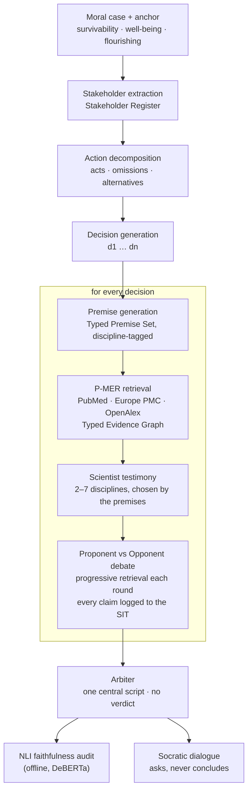

<div align="center">

# Polyphony

**Many voices, no verdict.**<br>
Evidence-grounded, multi-agent deliberation over moral dilemmas.


</div>

---

Polyphony takes a moral dilemma and lays out its whole decision space: every
alternative course of action, the premises each one rests on, what the scientific
literature says about those premises, and the strongest case for and against each
option. It then hands the reader one auditable **central script** and asks them
questions about it. It never says what the right answer is.

> The name comes from Bakhtin's *polyphonic novel*: many independent voices, none
> merged into the author's final word. Here the voices are nine models from nine
> different organisations, up to seven discipline scientists, and a proponent and an
> opponent for every decision. The final word stays with the human.

<br>

## How it works



| # | Stage | What happens | Code | Output folder |
|---|---|---|---|---|
| 1 | Ingestion | Text repair, anchor selection, dimension set | `src/ingestion/` | `01_ingestion` |
| 2 | Stakeholders | Every party the case affects, as a typed register (SR) | `src/ingestion/stakeholders.py` | `02_stakeholders` |
| 3 | Actions | Acts, omissions and alternatives open to the agent | `src/decisions/actions.py` | `03_actions` |
| 4 | Decisions | Distinct decision statements d1…dn (cosine dedup 0.90, max 6) | `src/decisions/generate.py` | `04_decisions` |
| 5 | Premises | Falsifiable, discipline-tagged premises per decision (TPS) | `src/premises/` | `05_premises` |
| 6 | Evidence | Progressive Moral Evidence Retrieval into a Typed Evidence Graph (TEG) with NLI contradiction edges | `src/evidence/` | `06_evidence_teg` |
| 7 | Testimony | Every discipline holding a premise testifies on it, citing evidence; no side taken | `src/testimony/` | `07_testimony` |
| 8 | Debate | Proponent vs opponent per decision, arguing over the testimony; every claim becomes a row in the Stakeholder Impact Trajectory (SIT) | `src/debate/`, `src/storage/sit.py` | `08_debate` |
| 9 | Arbiter | One central script for the whole case, compiled from testimony and debate only | `src/arbiter/` | `09_arbiter` |
| 10 | Socratic | 10 s gate, then a dialogue that answers facts and returns questions | `src/socratic/` | `10_socratic` |
| 11 | Evaluation | Rule-based, embedding and NLI metrics; baselines; reports | `src/eval/` | `11_eval` |

A debate stops when the premises are covered (coverage ≥ 0.90), when retrieval stops
finding anything new (novelty < 0.10 for two rounds), when coverage stalls for two
rounds, or after eight rounds.

<br>

## Three design laws

<table>
<tr>
<td width="33%" valign="top">

### 1 · No LLM scoring

Every quality signal is rule-based code, embedding geometry, or a separate NLI model
(DeBERTa-v3). No LLM ever grades text, including its own.

<sub>`src/services/nli.py` · `src/eval/`</sub>

</td>
<td width="33%" valign="top">

### 2 · One family per role

Nine LLM roles, nine organisations. The arbiter shares no family with anyone whose
text it compiles; no scientist testifies on premises its own model wrote.
`validate_models.py` refuses a roster that breaks this.

<sub>`config/models.yaml` · `src/services/model_registry.py`</sub>

</td>
<td width="33%" valign="top">

### 3 · No verdict

The arbiter compiles and never concludes. The Socratic stage answers factual
questions and returns the moral ones as questions. The human keeps the judgment.

<sub>`src/prompts/arbiter.py` · `src/prompts/socratic.py`</sub>

</td>
</tr>
</table>

<br>

## Model roster

All roles are reached through OpenRouter (`config/models.yaml`, `active: target_family`).

| Role | Model | Family |
|---|---|---|
| Stakeholder extraction | `google/gemini-3.1-flash-lite` | Google |
| Action decomposition | `qwen/qwen-plus` | Alibaba |
| Decision generation | `anthropic/claude-sonnet-5` | Anthropic |
| Premise generation | `x-ai/grok-4.7` | xAI |
| Scientist pool (7 personas) | `deepseek/deepseek-v4-pro-0813` | DeepSeek |
| Proponent | `moonshotai/kimi-k2.5` | Moonshot |
| Opponent | `z-ai/glm-5.3` | Zhipu |
| Arbiter | `openai/gpt-5.4-mini` | OpenAI |
| Socratic | `mistralai/mistral-large-2512` | Mistral |

The `interim_openai` column (OpenAI-only, one distinct model per role) is a fallback and
was not used for any reported run. Local models: `all-MiniLM-L6-v2` for embeddings and
`MoritzLaurer/DeBERTa-v3-base-mnli-fever-anli` for NLI, both downloaded on first use and
run on CPU.

<br>

## Quick start

```bash
pip install -r requirements.txt          # Python 3.10+
cp .env.example .env                     # OPENROUTER_API_KEY, OPENALEX_API_KEY, CONTACT_EMAIL

python scripts/validate_models.py        # role -> model table, heterogeneity check
python -m pytest tests/ -q               # no API keys needed

python scripts/run_full.py --variant my_run --worker my_run --sample 001
```

Results land in `outputs/my_run/`, one folder per stage plus a complete per-case bundle
in `full_pipeline/001.json`. Runs are resumable: re-running the same command skips
finished cases. Add `--interactive` to open the Socratic dialogue after each case.

<br>

## Reproducing the paper

Every command, with the exact variant and worker names used, is in
[`commands.txt`](commands.txt). The dataset is [`data/six_cases.csv`](data/six_cases.csv):
six dilemmas, ids 001–006.

| System | Command | US$ / case |
|---|---|---|
| **Polyphony (full)** | `run_full.py --variant main_audit --worker main_audit` | 0.456 |
| − Decision decomposition | `run_full.py --ablation no_decision_decomp …` | 0.093 |
| − Scientist testimony | `run_full.py --ablation no_testimony …` | 0.323 |
| − Progressive retrieval | `run_full.py --ablation no_pmer --worker pmer` | 0.494 |
| Fixed 4-scientist panel | `run_full.py --ablation fixed_panel --worker panel` | 0.452 |
| B1 · CoT self-consistency | `run_baseline.py --baseline b1 …` | 0.008 |
| B2 · single-pass RAG | `run_baseline.py --baseline b2 --teg-from main_audit …` | 0.014 |
| B3 · multi-agent debate (Du et al.) | `run_baseline.py --baseline b3 …` | 0.014 |
| B4 · full pipeline, one model | `run_baseline.py --baseline b4 --model deepseek/deepseek-v3.2 …` | 0.097 |
| B5 · original CogniAlign | `run_baseline.py --baseline b5 …` | 0.076 |

<sub>Costs are measured OpenRouter list prices (28 Oct 2026). A full-system case takes
80–130 min wall clock, most of it CPU-bound NLI.</sub>

After each run: `revote_baseline.py` (B1/B3), `recompute_faithfulness.py`,
`build_eval.py`, `export_case_text.py`, `token_report.py`. See `commands.txt` §3.

<br>

## What is measured

| Metric | Definition |
|---|---|
| **Faithfulness** | Share of the central script's substantive sentences entailed (DeBERTa, ≥ 0.60) by some window of the materials the arbiter was given; the top 5 windows per sentence are pre-ranked by MiniLM cosine |
| **Citation integrity** | Share of evidence-citing debate claims that the cited evidence entails |
| **Stakeholder coverage** | Share of the Stakeholder Register with at least one NLI-supported claim |
| **Premise coverage** | Share of each decision's premises the debate addresses |
| **Testimony citation integrity** | Share of evidence-citing scientist claims that the evidence entails |
| **Cost and time** | Tokens, wall clock and US$ per role, from per-call telemetry |

Macro means over the six cases:

| System | Faithfulness | Citation integrity | Stakeholder cov. | Premise cov. |
|---|---:|---:|---:|---:|
| **Polyphony (full)** | 0.644 | 0.091 | 0.925 | 0.723 |
| − Decision decomposition | 0.731 | 0.114 | 0.544 | 0.744 |
| − Scientist testimony | 0.644 | 0.139 | 0.917 | 0.788 |
| − Progressive retrieval | 0.613 | 0.148 | 0.958 | 0.688 |
| Fixed 4-scientist panel | 0.694 | 0.122 | 0.939 | 0.740 |
| B2 · single-pass RAG | 0.361 | – | – | – |
| B3 · multi-agent debate | 0.655 | – | – | – |
| B4 · full pipeline, one model | 0.798 | 0.076 | 0.854 | 0.800 |
| B5 · original CogniAlign | 0.725 | – | – | – |

<sub>B1 has no source materials, so faithfulness is undefined. Faithfulness sources
differ by system: pipeline arbiters see testimony and debate turns, B2 sees evidence
chunks, B3 and B5 see their own debate. With n = 6 no case-level difference survives
Holm correction; the paper reports the item-level tests.</sub>

<br>

## Repository layout

```
polyphony/
├── config/
│   ├── models.yaml        role → model roster, one family per role
│   └── settings.py        every hyperparameter, snapshotted into each run manifest
├── data/
│   └── six_cases.csv      the six dilemmas
├── scripts/               runners, scoring, reports, preflight
├── src/
│   ├── ingestion/         normalisation, anchor, Stakeholder Register
│   ├── decisions/         action decomposition, decision generation
│   ├── premises/          Typed Premise Set
│   ├── evidence/          P-MER: source clients, chunker, admission gate, TEG
│   ├── testimony/         discipline selection, personas, testimony
│   ├── debate/            proponent / opponent engine, coverage
│   ├── arbiter/           central script compilation
│   ├── socratic/          human gate, Socratic dialogue
│   ├── eval/              metrics, faithfulness, baselines, reports
│   ├── services/          LLM client, model registry, NLI, embedder, telemetry
│   ├── storage/           cases, vector DB, append-only SIT, outputs + resume ledger
│   ├── prompts/           every prompt, one file per stage
│   ├── schemas/           shared Pydantic types
│   └── pipeline/          per-case orchestration, batch driver
├── tests/                 offline tests, no API calls
├── commands.txt           every command, in order
└── requirements.txt
```

<details>
<summary><b>Key hyperparameters</b> (all in <code>config/settings.py</code>)</summary>

<br>

| Parameter | Value | Role |
|---|---|---|
| `novelty_threshold` | 0.20 | admit a chunk only if it adds this much novelty |
| `relevance_cosine_threshold` | 0.35 | topical relevance for admission, coverage and testimony |
| `contradiction_topic_cosine` | 0.50 | TEG contradiction edges only between related chunks |
| `nli_entailment_threshold` | 0.60 | entailment cut-off for every NLI check |
| `nli_faithfulness_top_k` | 5 | windows scored per script sentence |
| `chunk_tokens` / `chunk_overlap` | 140 / 32 words | evidence windows |
| `dedup_cosine_threshold` | 0.85 | premise deduplication |
| `decision_dedup_threshold` | 0.90 | decision deduplication |
| `scientist_floor` / `scientist_ceiling` | 2 / 7 | disciplines that testify |
| `max_decisions` | 6 | decision fan-out |
| `max_rounds` | 8 | debate rounds |
| `coverage_stop_threshold` | 0.90 | stop when premises are covered |
| `novelty_stop_threshold` × rounds | 0.10 × 2 | stop when retrieval runs dry |
| `coverage_stall_rounds` | 2 | stop when coverage stops improving |
| `query_gate_timeout_s` | 10 | Socratic gate |

</details>

<details>
<summary><b>Evidence sources</b></summary>

<br>

PubMed (E-utilities), Europe PMC and OpenAlex, all free. Crossref is queried only as a
last resort when every other source returns nothing; in the main run all admitted
evidence came from the first three. A Semantic Scholar client is included and switched
off (`use_semantic_scholar = False`) because it needs a key, so every variant searches
the same sources. Every fetched abstract is chunked,
embedded and kept in a per-worker FAISS corpus, so retrieval is local-first and the
corpus grows across cases within a run. Each variant starts from an empty corpus.

</details>

<details>
<summary><b>Outputs</b></summary>

<br>

```
outputs/<variant>/
├── 01_ingestion/<id>/ … 11_eval/      one folder per stage, one subfolder per case
├── full_pipeline/<id>.json            the complete case bundle
├── telemetry/                         calls, retrieval, events, token_report
└── processed_samples.txt              resume ledger
```

A case id enters the ledger only after the whole pipeline has finished and every file is
written, so an interrupted case is redone, never half-counted.

</details>

<br>

## Citation

```bibtex
@misc{polyphony2026,
  title  = {Polyphony: Evidence-Grounded Multi-Agent Deliberation over Moral Dilemmas without a Verdict},
  author = {Anonymous},
  year   = {2026},
  note   = {Under review}
}
```
